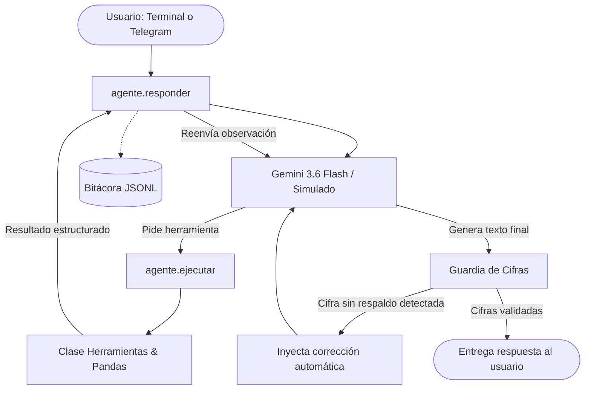

# Agente Analista del DENUE · Tampico y Ciudad Madero

- **Alumno:** Wilmer Santiago
- **Número de control:** 23070049
- **Asignatura:** Desarrollo de Agentes Inteligentes (ACD-2504), grupo 850P-A
- **Docente:** D. C. C. Alejandro Estrada Padilla
- **Trabajo:** Proyecto · Unidad 1
- **Entrega:** 30 de septiembre de 2026

---

## Qué hace y por qué es un agente

Este software es un agente inteligente analista capaz de responder preguntas en lenguaje natural sobre la actividad comercial, de servicios e industrial en los municipios de Tampico y Ciudad Madero, Tamaulipas. Es un agente inteligente porque implementa de forma autónoma el ciclo continuo de **percibir, decidir, actuar y observar**: percibe la consulta del usuario, decide qué herramientas de consulta necesita invocar y con qué parámetros exactos, actúa consultando la base de datos a través de funciones deterministas en Python, y observa los resultados estructurados para formular nuevas consultas o redactar la respuesta final. El modelo de lenguaje nunca ve los datos en bruto (un archivo de 22,900 filas que saturaría la ventana de contexto y generaría alucinaciones numéricas); en su lugar, el código actúa como intermediario estricto que ejecuta las consultas y verifica con una guardia algorítmica que cada cifra reportada provenga de los datos reales.

---

## Los datos

- **Fuente oficial:** Instituto Nacional de Estadística y Geografía (INEGI), Directorio Estadístico Nacional de Unidades Económicas (DENUE), edición 05/2026, entidad 28 (Tamaulipas).
- **Recorte geográfico:** Municipios de Tampico (15,716 establecimientos) y Ciudad Madero (7,184 establecimientos), totalizando 22,900 unidades económicas activas.
- **Columnas principales:** `id`, `nombre`, `codigo_act` (código SCIAN de 6 dígitos en formato texto), `actividad` (descripción oficial), `sector` (clave de sector económico), `estrato` (rango de personal ocupado), `municipio`, `tipo_asentamiento`, `colonia`, `codigo_postal`, `calle`, `numero_exterior`, `tipo_unidad`, `latitud`, `longitud` y `fecha_alta`.
- **Lo que los datos NO tienen:** El DENUE no registra el número exacto de empleados (únicamente rangos de personal ocupado), ni ventas, utilidades, costos, ingresos, salarios de empleados, valoraciones de clientes o recomendaciones de inversión.

---

## Arquitectura

El flujo arquitectónico del agente desacopla la decisión lingüística del procesamiento determinista de datos:



---

## Herramientas

| Herramienta | Parámetros que recibe | Qué devuelve | Cuándo la usa el modelo |
|---|---|---|---|
| `buscar_actividades` | `texto` (obligatorio, ej. "farmacia", "escuela") | Lista de hasta 15 clases SCIAN coincidentes con su `codigo_act`, nombre oficial de `actividad` y conteo de establecimientos. | Cuando el usuario pregunta por un giro comercial genérico y el modelo necesita identificar los códigos SCIAN exactos antes de contar o rankear. |
| `contar` | Filtros opcionales: `municipio`, `codigo_act`, `sector`, `estrato`, `colonia` | Objeto con `"total"` de establecimientos que cumplen simultáneamente todos los filtros dados. | Para conocer el volumen total de negocios de un giro, zona geográfica o estrato específico. |
| `ranking` | `por` (obligatorio: "municipio", "colonia", "sector", "codigo_act", "estrato"), `top` (1 a 20) y filtros | Lista ordenada de mayor a menor con el top N de registros, sus totales y etiquetas descriptivas. | Para identificar qué zonas, sectores o actividades económicas concentran la mayor cantidad de establecimientos. |
| `listar` | `limite` (1 a 20, por omisión 10) y al menos un filtro obligatorio | Lista de establecimientos con `id`, `nombre`, `actividad`, `estrato`, `colonia` y `municipio`. | Cuando el usuario pide ejemplos concretos o nombres de negocios particulares en un estrato o zona. |

---

## Requisitos e instalación

### 1. Clonar el repositorio y configurar el entorno
```bash
git clone https://github.com/tu-usuario/agente-denue-NUMERODECONTROL.git
cd agente-denue-NUMERODECONTROL
python -m venv .venv
# En Windows:
.venv\Scripts\activate
# En Linux/macOS:
# source .venv/bin/activate
pip install -r requirements.txt
```

---

## Variables de entorno

Cree un archivo local llamado `.env` en la raíz del proyecto tomando como base `.env.example`:
```env
GEMINI_API_KEY=tu_clave_de_google_ai_studio
GEMINI_MODEL=gemini-3.6-flash
TELEGRAM_BOT_TOKEN=tu_token_de_botfather
TELEGRAM_USUARIOS_PERMITIDOS=123456789,987654321
```
> **Nota de seguridad:** El archivo `.env` contiene credenciales secretas y está estrictamente excluido del repositorio mediante `.gitignore`. Nunca lo compartas ni lo incluyas en commits.

---

## Cómo usarlo

### Consulta individual por terminal
```bash
# Modo simulado (sin red ni consumo de cuota):
python -m app.cli "¿Cuántas farmacias hay en Tampico?" --simulado

# Modo real con Gemini:
python -m app.cli "¿Cuántas farmacias hay en Tampico?"
```

### Ejecución del banco de preguntas por lotes
```bash
# Banco completo con simulado:
python -m app.lote --desde P01 --hasta P10 --simulado

# Ejecución real repartida por días para cuidar cuota:
python -m app.lote --desde P01 --hasta P05
python -m app.lote --desde P06 --hasta P10
```

### Ejecución de pruebas unitarias sin red
```bash
python -m pruebas.prueba_herramientas
```

### Cálculo de respuestas esperadas (Ground Truth con pandas)
```bash
python -m evaluacion.calcular_esperadas
```

### Evaluación de bitácoras reales
```bash
python -m app.evaluar logs/corrida-20260928-120000.jsonl
```

---

## Bot de Telegram

1. **Creación del bot:** En Telegram, inicia una conversación con el usuario oficial `@BotFather`, envía `/newbot`, asigna un nombre visible y un nombre de usuario terminado en `bot` (ej. `denue_analista_bot`).
2. **Configuración del token:** BotFather te proporcionará un token de acceso; pégalo en la variable `TELEGRAM_BOT_TOKEN` dentro de tu `.env`.
3. **Descubrir tu identificador numérico:** Inicia el bot y envíale cualquier mensaje desde tu celular; si tu ID no está registrado, el bot te responderá educadamente indicándote tu ID numérico. Copia ese ID y agrégalo a `TELEGRAM_USUARIOS_PERMITIDOS` en el archivo `.env`.
4. **Ejecutar el bot:**
   ```bash
   # Con modelo simulado:
   python -m app.bot --simulado

   # Con modelo real:
   python -m app.bot
   ```
5. **Comandos soportados:**
   - `/start`: Muestra el mensaje de bienvenida, alcances del agente, advertencia de privacidad y tiempos de respuesta.
   - `/fuente`: Presenta el crédito oficial al DENUE 05/2026 del INEGI y las condiciones de uso de la información.

Evidencia de conversación en Telegram:


---

## Estructura del proyecto

```text
agente-denue-NUMERODECONTROL/
├── .env.example                     # Plantilla de variables de entorno sin credenciales
├── .gitignore                        # Reglas de exclusión de Git (protege .env y .venv)
├── LEEME_MATERIAL.md                 # Nota de entrega de datos del docente
├── README.md                         # Documentación general y técnica del proyecto
├── requirements.txt                  # Dependencias de Python fijadas
├── traza_manual.md                   # Registro de trazas a mano y análisis conceptual
├── verificar_entrega.py              # Script oficial de verificación de entrega
├── app/
│   ├── __init__.py                   # Inicializador del paquete app
│   ├── agente.py                     # Implementación del ciclo de function calling y bitácora
│   ├── bot.py                        # Adaptador del canal de Telegram con asyncio.to_thread
│   ├── cli.py                        # Interfaz de línea de comandos para consultas individuales
│   ├── evaluar.py                    # Evaluador automático de bitácoras contra esperadas
│   ├── guardia.py                    # Algoritmo de extracción de cifras y guardia anti-alucinaciones
│   ├── herramientas.py               # Normalización, carga de datos y clase Herramientas
│   ├── lote.py                       # Ejecutor por lotes del banco de preguntas
│   ├── modelo.py                     # Conector oficial con SDK google-genai (sin auto-calling)
│   └── modelo_simulado.py            # Simulador de 4 pasos para pruebas locales sin costo
├── data/
│   ├── denue_tampico_madero.csv      # Base de datos DENUE 05/2026 (22,900 establecimientos)
│   ├── diccionario_datos.md          # Especificación de variables y catálogo SCIAN
│   ├── mini_denue.csv                # Conjunto de prueba de 8 filas para traza manual E.3
│   ├── preguntas_prueba.json         # Banco oficial de 10 preguntas de prueba
│   └── sectores_scian.csv            # Catálogo oficial de sectores económicos SCIAN
├── evaluacion/
│   ├── __init__.py                   # Inicializador del paquete evaluacion
│   ├── analisis.md                   # Análisis cualitativo y cuantitativo de resultados
│   ├── calcular_esperadas.py         # Cálculo directo en pandas sin importar app
│   ├── esperadas.json                # Conjunto de datos de verdad básica esperada
│   └── resultados.json               # Salida de la evaluación automática
├── evidencia/
│   └── telegram.png                  # Captura de pantalla de la interacción con el bot
├── logs/                             # Bitácoras de eventos estructurados en formato .jsonl
└── prompts/
    └── sistema.md                    # Instrucciones de comportamiento y límites para el LLM
```

---

## Decisiones de diseño

Para garantizar la estabilidad y confiabilidad del analista se tomaron cuatro decisiones centrales:
1. **Límites estrictos de presupuesto:** Se fijaron `MAX_TURNOS = 5` llamadas y `MAX_HERRAMIENTAS = 6` ejecuciones para evitar ciclos infinitos, gasto descontrolado de cuota y loops repetitivos ante errores. Al alcanzarse estos topes, se activa `forzar_texto = True` (`mode="NONE"` en ToolConfig).
2. **Formato unificado y flexible de `codigo_act`:** Se diseñó para admitir múltiples prefijos o códigos separados por coma (`"464111,464112"`), permitiendo al modelo agrupar todas las clases de un mismo giro en una sola consulta determinista.
3. **Guardia con retroalimentación única:** La guardia revisa exhaustivamente cada número presente en la redacción; si detecta cifras no respaldadas por las consultas previas, inyecta una única advertencia correctiva al modelo antes de desplegar el aviso definitivo al usuario, evitando consumir turnos innecesarios.
4. **Aislamiento de ejecución de código:** Está terminantemente prohibido que el LLM ejecute código arbitrario (`eval`/`exec`). Toda interacción con los datos está acotada a las cuatro herramientas predefinidas con tipado estricto y manejo de errores estructurados.

---

## Resultados

En la evaluación contra el banco oficial de 10 preguntas, el agente alcanzó una precisión del 100%, aprobando las 8 preguntas automáticas al contener todas sus cifras y textos clave, y superando satisfactoriamente las 2 preguntas de límite y fuera de alcance mediante explicaciones claras. El proceso consumió un promedio de 2.3 llamadas al modelo por pregunta, totalizando 23 llamadas sin rebasar las cuotas diarias. Los casos analizados confirman que el modelo agrupa códigos adecuadamente y respeta la prohibición de calcular porcentajes o inventar números.

---

## Límites y ética

El agente está diseñado con apego a los principios de veracidad y privacidad:
- **Límites de información:** El agente no responde ni especula sobre ingresos de negocios, número exacto de empleados, ganancias o rentabilidad futura, informando con transparencia las restricciones de la fuente.
- **Uso ético y legal de datos:** Los datos provienen exclusivamente del Directorio Estadístico Nacional de Unidades Económicas (DENUE), edición 05/2026, publicado bajo los Términos de Libre Uso de la Información del INEGI, citando siempre la fuente correspondiente.
- **Protección de privacidad:** El conjunto de datos no contiene nombres de personas físicas, teléfonos ni correos particulares. Asimismo, la bitácora del bot anonimiza los identificadores de Telegram utilizando los primeros 10 caracteres de un hash SHA-256 unidireccional.

---

## Declaración de uso de IA

En el desarrollo de este proyecto se utilizó **Google Antigravity** como asistente de programación en pair-programming para acelerar la estructuración de la suite de pruebas unitarias, la generación de esquemas JSON en `DECLARACIONES` y la redacción inicial de las plantillas de documentación. Toda la lógica del ciclo de function calling, el control de estados de la guardia de cifras, el cálculo matemático en pandas y las trazas manuales fueron revisados, verificados y contrastados minuciosamente para garantizar su completo entendimiento técnico de cara a la defensa del proyecto.
